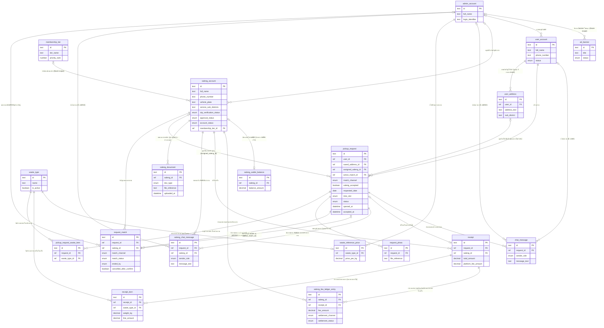

# Database Schema (Conceptual)

> เอกสารนี้อธิบายโครงสร้างข้อมูลในระดับแนวคิด (conceptual) เท่านั้น **ไม่ผูกมัดกับ database engine หรือ data type เฉพาะเจาะจงใดๆ** การเลือก engine จริงจะอยู่ในเอกสารแยกต่างหากภายใต้โฟลเดอร์เดียวกันนี้เมื่อถึงขั้นตอนออกแบบเชิงเทคนิค

## ภาพรวม

เอกสารนี้สกัดโครงสร้างข้อมูลจาก [[../../01-requirements/01-spec/20260819-001-saleng-pickup-request|Call-Saleng: ระบบเรียกรถซาเล้งมารับซื้อขยะ Recycle ที่บ้าน]] ทั้งฉบับ ครอบคลุมทั้ง 3 บทบาท (User/Saleng/Admin) โดยอ้างอิงชื่อ component เชิงแนวคิดจาก [[high-level-architecture|High-Level Architecture (Conceptual)]] ให้สอดคล้องกัน — โดยเฉพาะ **Data Store** (เก็บบัญชี/คำขอ/การจับคู่/ใบเสร็จ/ราคากลาง), **Media/File Storage** (เก็บรูปถ่ายขยะแยกต่างหาก — ในเอกสารนี้ตาราง `request_photo` เก็บเพียง reference ไปยังไฟล์ ไม่ใช่ไฟล์จริง) และ **Matching/Assignment** (สะท้อนเป็นตาราง `request_match` แยกจากตาราง `pickup_request` หลัก เพื่อรองรับกลไก self-pick/admin-assign และเตรียมพร้อมสำหรับ auto-matching ในอนาคตตามที่ระบุใน high-level-architecture)

**อัปเดต 2026-11-07:** ต่อยอดตาม [[../../01-requirements/01-spec/20260912-002-saleng-auto-matching|ระบบจับคู่งานสาเล้งตามพื้นที่ (ตำบล) + Admin-assign และการจัดการสาเล้ง]] (spec 002 — หัวข้อ "ผลกระทบต่อเอกสารอื่น" ข้อ 7) ให้ตรงกับสิ่งที่พัฒนาจริงในรอบนี้แล้ว ได้แก่ การสมัคร/อนุมัติสาเล้งพร้อมเอกสาร (`saleng_account` + ตารางใหม่ `saleng_document`), ตำบลที่รับงานหลายค่า, field การจับคู่ที่ denormalize ไว้ใน `pickup_request`, ชุดสถานะใหม่ของ `request_match` (สาเล้งต้องตอบรับงานที่ Admin มอบหมาย, การยุติการจับคู่โดยสาเล้ง/Admin), และห้องแชท Admin–สาเล้ง (ตารางใหม่ `saleng_chat_message`)

แบ่งกลุ่มตารางออกเป็น 7 กลุ่มตามบทบาทและ business rule ของสเปก:

1. **บัญชีผู้ใช้ทั้ง 3 บทบาท** — `user_account`, `user_address`, `saleng_account`, `saleng_document`, `admin_account`
2. **คำขอเรียกรถซาเล้งและรายละเอียดประกอบ** — `pickup_request`, `pickup_request_waste_item`, `request_photo`
3. **ราคากลางอ้างอิง** — `waste_type`, `waste_reference_price`
4. **การจับคู่งาน (self-pick / admin-assign)** — `request_match`
5. **ใบเสร็จและค่าธรรมเนียม platform** — `receipt`, `receipt_item`, `saleng_fee_ledger_entry`, `saleng_wallet_balance`
6. **การสื่อสาร** — `chat_message` (User–Admin), `saleng_chat_message` (Admin–สาเล้ง)
7. **เผื่อรองรับโมเดลธุรกิจในอนาคต (future scope, minimal)** — `membership_tier`, `ad_banner`

## ER Diagram



## รายละเอียดตาราง

### user_account

เก็บบัญชี User/เจ้าของขยะ ตาม [[../../01-requirements/feature-list#User|สมัครสมาชิก/เข้าสู่ระบบ]] และ [[../../01-requirements/feature-list#User|จัดการโปรไฟล์ส่วนตัว]] `phone_number` ใช้เป็นข้อมูลติดต่อที่ส่งต่อให้สาเล้งเห็นหลัง match confirm ตาม business rule เรื่องการแลกข้อมูลติดต่อ

| Field | Type | Required | คำอธิบาย |
|---|---|---|---|
| id | text | ใช่ | รหัสอ้างอิงเฉพาะของบัญชี |
| full_name | text | ใช่ | ชื่อผู้ใช้ ใช้เป็นค่าเริ่มต้นของ `contact_name` ตอนสร้างคำขอ |
| phone_number | text | ใช่ | เบอร์โทรติดต่อ, unique, ใช้เป็นค่าเริ่มต้นของ `contact_phone` และเป็นข้อมูลที่ส่งให้สาเล้งเห็นหลัง confirm |
| status | enum | ใช่ | `active` / `suspended` — ตาม business rule "Admin ระงับบัญชี user ที่ทำผิดกฎ" บัญชี `suspended` ไม่สามารถสร้างคำขอใหม่ได้ |
| created_at | datetime | ใช่ | วันเวลาที่สมัครสมาชิก |
| suspended_at | datetime | ไม่ | วันเวลาที่ถูกระงับ (null ถ้ายัง active) |
| suspended_by | reference → admin_account | ไม่ | Admin ที่กดระงับบัญชีนี้ |
| suspend_reason | text | ไม่ | เหตุผลการระงับ เพื่อใช้อ้างอิงภายหลัง |

### user_address

รองรับ [[../../01-requirements/feature-list#User|เลือกใช้ที่อยู่ที่บันทึกไว้ในโปรไฟล์แทนกรอกใหม่]] เป็นที่อยู่ "ต้นแบบ" ที่ User เลือกดึงมาใช้ตอนสร้างคำขอได้ — ไม่ใช่ที่อยู่จริงที่ผูกกับคำขอแต่ละครั้ง (ที่อยู่จริงของคำขอถูก snapshot แยกไว้ใน `pickup_request` เพื่อไม่ให้เปลี่ยนย้อนหลังถ้า User แก้ไขที่อยู่ในโปรไฟล์ภายหลัง)

**Business rule (ยืนยันแล้ว):** 1 บัญชี User บันทึกที่อยู่ต้นแบบไว้ใช้ซ้ำได้ **สูงสุด 2 รายการ** (เช่น "บ้าน" กับ "ที่ทำงาน/ร้าน") — เป็นการตัดสินใจเชิง business จริง ไม่ใช่แค่ข้อจำกัดทาง implementation แม้ requirement spec ต้นทางจะไม่ได้ระบุตัวเลขนี้ตรงๆ

| Field | Type | Required | คำอธิบาย |
|---|---|---|---|
| id | text | ใช่ | รหัสอ้างอิงที่อยู่ |
| user_id | reference → user_account | ใช่ | เจ้าของที่อยู่นี้ |
| label | text | ไม่ | ป้ายกำกับที่อยู่ เช่น "บ้าน", "ร้าน" |
| address_text | text | ใช่ | รายละเอียดที่อยู่ |
| sub_district | text | ไม่ | ตำบล/พื้นที่ย่อยภายในเขตอำเภอเมือง เชียงราย ใช้ประกอบการกรองรายการของสาเล้ง (ดูหมายเหตุใน "สมมติฐานและข้อจำกัด") |
| landmark | text | ไม่ | จุดสังเกตเพิ่มเติม |
| gps_latitude | decimal | ไม่ | พิกัด GPS (ทางเลือกแทน/เสริมที่อยู่ ตาม business rule "ที่อยู่ หรือพิกัด GPS") |
| gps_longitude | decimal | ไม่ | พิกัด GPS |
| is_default | boolean | ใช่ | ที่อยู่เริ่มต้นที่แนะนำตอนสร้างคำขอ |
| created_at | datetime | ใช่ | วันเวลาที่บันทึกที่อยู่นี้ |

Constraint: จำนวนแถวของ `user_address` ต่อ `user_id` ต้องไม่เกิน **2** ตาม business rule ข้างต้น

### saleng_account

เก็บบัญชี Saleng/คนขับ ตาม [[../../01-requirements/feature-list#Saleng|ลงทะเบียน/เข้าสู่ระบบ]] และ business rule ข้อ 6 "การสมัครและสถานะบัญชีสาเล้ง" ของ [[../../01-requirements/01-spec/20260912-002-saleng-auto-matching|spec 002]] บังคับใช้ business rule "สาเล้งต้องได้รับการอนุมัติจาก Admin ก่อนจึงจะเห็นและรับงานได้" ผ่าน `approval_status` แยกจาก `account_status` (สถานะระงับ) เพื่อให้ตรวจสอบเงื่อนไข "อนุมัติแล้ว" และ "ไม่ถูกระงับ" ได้อิสระจากกัน

ข้อมูลสมัครตาม spec 002: ชื่อ, เบอร์โทร, ทะเบียนรถ, รูปรถ, รูปบัตรประชาชน และตำบลที่รับงาน (หลายตำบล) — รูปทั้งสองแบบแยกเก็บในตาราง [[#saleng_document|saleng_document]] ไม่เก็บในตารางนี้ ระหว่าง `approval_status = pending` สาเล้งเข้าสู่ระบบได้แต่ยังไม่เห็นงานใดๆ

| Field | Type | Required | คำอธิบาย |
|---|---|---|---|
| id | text | ใช่ | รหัสอ้างอิงบัญชีสาเล้ง (ผูกกับตัวตนที่ใช้เข้าสู่ระบบ) |
| full_name | text | ใช่ | ชื่อสาเล้ง — คัดลอกไปไว้ที่ `pickup_request.assigned_saleng_name` ตอนจับคู่ |
| phone_number | text | ใช่ | เบอร์โทร, unique, ใช้เป็นตัวระบุตอนเข้าสู่ระบบ (เบอร์โทร + รหัสผ่าน) และเป็นข้อมูลที่ส่งให้ User เห็นหลัง confirm |
| vehicle_plate | text | ใช่ | ทะเบียนรถ — ใช้ให้ Admin ตรวจตอนอนุมัติ และแสดงให้ลูกค้าเห็นหลัง confirm (คัดลอกไปที่ `pickup_request.assigned_saleng_plate`) |
| service_sub_districts | text (หลายค่า / list) | ใช่ | รายการตำบลที่สาเล้งลงทะเบียนรับงาน (เลือกได้มากกว่า 1 ตำบล อย่างน้อย 1) — ใช้กรองรายการงานเปิดที่สาเล้งเห็น: เห็นเฉพาะคำขอที่ `pickup_request.sub_district` อยู่ในรายการนี้ |
| otp_verification_status | enum | ไม่ | **ไม่ได้ใช้ใน MVP** — `verified` / `unverified` เดิมออกแบบไว้สำหรับยืนยันตัวตนด้วย OTP ตาม spec หลัก แต่การพัฒนารอบนี้สาเล้งเข้าสู่ระบบด้วยเบอร์โทร + รหัสผ่าน (แบบเดียวกับ User) และใช้การตรวจเอกสารโดย Admin แทน (spec 002 ข้อ 6) จึงไม่มีการเขียนค่า field นี้ — คงไว้ (ไม่ลบ) เผื่อเปิดใช้ OTP ในอนาคต |
| approval_status | enum | ใช่ | `pending` / `approved` / `rejected` — ผลการตรวจสอบของ Admin ก่อนให้สิทธิ์เข้าดู/รับงาน (`pending` ตรงกับ `pending_approval` ในถ้อยคำของ spec 002) ค่าเริ่มต้นตอนสมัคร = `pending` |
| account_status | enum | ใช่ | `active` / `suspended` — Admin ระงับได้ทุกเมื่อ (ต้องมีเหตุผล), บัญชี `suspended` ไม่เห็นงานและรับงานใหม่ไม่ได้; Admin "เปิดใช้งานอีกครั้ง" ได้ (กลับเป็น `active` และล้าง `suspend_reason`) ค่าเริ่มต้นตอนสมัคร = `active` |
| reject_reason | text | ไม่ | เหตุผลที่ไม่อนุมัติ — **บังคับกรอกเมื่อ** `approval_status = rejected` (spec 002 "reject ต้องระบุเหตุผล") ล้างเป็น null เมื่ออนุมัติภายหลัง |
| reviewed_at / reviewed_by | datetime / reference → admin_account | ไม่ | เวลาและ Admin ที่ตรวจสอบใบสมัครครั้งล่าสุด (ทั้งกรณีอนุมัติและไม่อนุมัติ) |
| approved_at / approved_by | datetime / reference → admin_account | ไม่ | วันเวลาและ Admin ผู้ตรวจสอบตอนอนุมัติ |
| suspended_at / suspended_by | datetime / reference → admin_account | ไม่ | เวลาและ Admin ที่ระงับบัญชีครั้งล่าสุด |
| suspend_reason | text | ไม่ | เหตุผลการระงับ — **บังคับกรอกเมื่อ** `account_status = suspended` ล้างเป็น null เมื่อเปิดใช้งานอีกครั้ง |
| membership_tier_id | reference → membership_tier | ไม่ | **เผื่อรองรับอนาคต**: ระดับสมาชิกรายเดือน (ยังไม่มีฟีเจอร์จริงใน MVP เพราะค่าสมาชิกชำระ manual นอกระบบ) |
| created_at | datetime | ใช่ | วันเวลาที่ลงทะเบียน |

หมายเหตุสิทธิ์ "สาเล้งที่ใช้งานได้": สาเล้งจะเห็นงานเปิด รับงาน ตอบรับงาน และแชทกับ Admin ได้ก็ต่อเมื่อ `approval_status = approved` **และ** `account_status = active` พร้อมกันเท่านั้น ระบบจริงมีกลไกเช็กสิทธิ์นี้แยกต่างหาก (เครื่องหมาย "สาเล้งที่ใช้งานได้" ที่ถูกสร้างตอน Admin อนุมัติ/เปิดใช้งานอีกครั้ง และถูกลบตอนระงับ) เพื่อให้ตรวจสิทธิ์ได้เร็วโดยไม่ต้องอ่านทั้งบัญชี — เป็นรายละเอียดการ implement ที่สืบทอดค่าจาก 2 field ข้างต้น จึงไม่สร้างเป็นตารางเชิงแนวคิดแยก

หมายเหตุ: สถานะ "ว่าง / กำลังทำงาน" ที่ Admin เห็นในหน้าจัดการรถซาเล้ง ([[../../01-requirements/feature-list#Admin|ดูสถานะสาเล้งแต่ละคน]]) เป็นค่าที่ **คำนวณ (derived)** จากการมี/ไม่มี `request_match` ที่ `match_status = confirmed` และ `pickup_request` ที่เกี่ยวข้องยังไม่ `completed`/`cancelled` ของสาเล้งคนนั้น ไม่ได้เก็บเป็น field แยกต่างหากในตารางนี้ เพื่อไม่ให้ข้อมูลไม่ตรงกับความจริง (single source of truth มาจาก `request_match`) — ในทำนองเดียวกัน **โควตาคิว** (จำนวนงานในรอบ และจำนวนงานค้างรวม) และ **สถิติการยกเลิกหลังยืนยัน** ของสาเล้งแต่ละคน ก็เป็นค่าคำนวณจาก `pickup_request`/`request_match` ไม่ได้เก็บเป็น field (ดู "สมมติฐานและข้อจำกัด")

### saleng_document

เอกสารประกอบการสมัครของสาเล้ง ตาม spec 002 ข้อ 6 — รูปรถ และรูปบัตรประชาชน ให้ Admin ใช้ตรวจก่อนอนุมัติ เก็บแยกจาก `saleng_account` เพราะเป็นไฟล์รูป (เก็บใน **Media/File Storage** ตาม high-level-architecture เช่นเดียวกับ `request_photo`) และมีสิทธิ์การอ่านเข้มกว่าข้อมูลบัญชีทั่วไป

**ข้อมูลอ่อนไหว:** รูปบัตรประชาชนอ่านได้เฉพาะเจ้าของบัญชีและ Admin เท่านั้น (สาเล้งคนอื่น/ลูกค้าอ่านไม่ได้) และ **ระบบทดสอบใช้รูปจำลองเท่านั้น ห้ามอัปโหลดบัตรประชาชนจริง** (spec 002 ข้อ 6)

| Field | Type | Required | คำอธิบาย |
|---|---|---|---|
| id | text | ใช่ | รหัสอ้างอิงเอกสาร |
| saleng_id | reference → saleng_account | ใช่ | สาเล้งเจ้าของเอกสาร |
| doc_type | enum | ใช่ | `vehicle_photo` (รูปรถ) / `id_card_photo` (รูปบัตรประชาชน) |
| file_reference | text | ใช่ | ตัวชี้ไปยังไฟล์รูปใน Media/File Storage (เชิงแนวคิด — รูปแบบการเก็บจริงขึ้นกับการ implement) |
| uploaded_at | datetime | ใช่ | วันเวลาที่อัปโหลด (ตอนสมัคร) |

Constraint: สาเล้ง 1 คนต้องมีเอกสาร `doc_type` ละ 1 รายการเป็นอย่างน้อยตอนสมัคร (1 รูป = 1 แถว) — เอกสารเป็นข้อมูลที่สร้างตอนสมัครเท่านั้น ยังไม่มี flow แก้ไข/อัปโหลดใหม่หลังสมัครในรอบนี้

### admin_account

เก็บบัญชี Admin/ผู้ดูแลระบบ ออกแบบขั้นต่ำเพราะสเปกไม่ได้ระบุรายละเอียดการสมัคร/สิทธิ์ของ Admin (สันนิษฐานว่าเป็นบัญชีที่สร้างไว้ล่วงหน้า ไม่มีขั้นตอนสมัครสมาชิกแบบ User/Saleng)

| Field | Type | Required | คำอธิบาย |
|---|---|---|---|
| id | text | ใช่ | รหัสอ้างอิงบัญชี Admin |
| full_name | text | ใช่ | ชื่อผู้ดูแลระบบ |
| login_identifier | text | ใช่ | ข้อมูลใช้เข้าสู่ระบบ (unique) เชิงแนวคิด ไม่ผูกรูปแบบ auth เฉพาะเจาะจง |
| created_at | datetime | ใช่ | วันเวลาที่สร้างบัญชี |

### waste_type

ตารางอ้างอิงประเภทขยะ recycle (กระดาษ, พลาสติก, เหล็ก, อลูมิเนียม, ขวดแก้ว ฯลฯ) ใช้ร่วมกันทั้งตอน User เลือกประเภทขยะในคำขอ, Admin ตั้งราคากลาง, และสาเล้งกรอกใบเสร็จ — ดูเหตุผลการเลือก normalize แบบตารางอ้างอิงใน "สมมติฐานและข้อจำกัด"

| Field | Type | Required | คำอธิบาย |
|---|---|---|---|
| id | text | ใช่ | รหัสอ้างอิงประเภทขยะ |
| name | text | ใช่ | ชื่อประเภท (unique) เช่น "พลาสติก" |
| is_active | boolean | ใช่ | ใช้ปิดการใช้งานประเภทที่เลิกรับซื้อ โดยไม่ต้องลบข้อมูลย้อนหลัง |
| created_at | datetime | ใช่ | วันเวลาที่เพิ่มประเภทนี้เข้าระบบ |

### waste_reference_price

ราคากลางอ้างอิงต่อกิโลกรัมของแต่ละประเภท ตาม [[../../01-requirements/feature-list#Admin|อัปเดตราคากลางขยะต่อกิโลกรัมของแต่ละประเภท]] — เป็นราคาปัจจุบันเท่านั้น (ไม่มี audit trail แบบตารางประวัติแยก ตามที่ตัดสินใจไว้ใน "สมมติฐานและข้อจำกัด")

| Field | Type | Required | คำอธิบาย |
|---|---|---|---|
| id | text | ใช่ | รหัสอ้างอิง |
| waste_type_id | reference → waste_type | ใช่ | ประเภทขยะที่ราคานี้ผูกอยู่ (unique — 1 ประเภทมีราคากลางปัจจุบันได้ 1 ค่า) |
| price_per_kg | decimal | ใช่ | ราคาอ้างอิงต่อกิโลกรัม (บาท) — เป็นข้อมูลอ้างอิงเท่านั้น ไม่ผูกกับธุรกรรมจริงตาม business rule |
| updated_at | datetime | ใช่ | วันเวลาที่แก้ไขล่าสุด |
| updated_by | reference → admin_account | ใช่ | Admin ที่แก้ไขราคาล่าสุด |

### pickup_request

ตารางหลักของระบบ แทนคำขอเรียกรถซาเล้ง 1 รายการ ครอบคลุมฟอร์มตาม [[../../01-requirements/feature-list#User|สร้างคำขอเรียกรถซาเล้งด้วยฟอร์มรายละเอียด]] และ business rule "พื้นที่ให้บริการจำกัดเฉพาะเขตอำเภอเมือง เชียงราย" (ตรวจสอบก่อนสร้าง ไม่ได้เก็บเป็น field พิเศษ) ที่อยู่ในตารางนี้เป็น **snapshot ณ ตอนสร้างคำขอ** แยกจาก `user_address` เพื่อไม่ให้ข้อมูลของคำขอเก่าเปลี่ยนตามถ้า User แก้ไขที่อยู่ในโปรไฟล์ภายหลัง

| Field | Type | Required | คำอธิบาย |
|---|---|---|---|
| id | text | ใช่ | รหัสอ้างอิงคำขอ |
| user_id | reference → user_account | ใช่ | User เจ้าของคำขอ |
| saved_address_id | reference → user_address | ไม่ | ที่อยู่ต้นแบบที่ถูกเลือกใช้ (null ถ้ากรอกที่อยู่ใหม่โดยไม่บันทึก) |
| contact_name | text | ใช่ | ชื่อผู้ติดต่อของคำขอนี้ (ดึงจาก profile หรือกรอกใหม่) |
| contact_phone | text | ใช่ | เบอร์โทรติดต่อของคำขอนี้ |
| address_text | text | ใช่ | ที่อยู่ (snapshot) |
| sub_district | text | ไม่ | ตำบล/พื้นที่ย่อย (snapshot) ใช้กรองรายการของสาเล้ง |
| landmark | text | ไม่ | จุดสังเกต (snapshot) |
| gps_latitude / gps_longitude | decimal | ไม่ | พิกัด GPS (snapshot) |
| requested_date | date | ใช่ | วันที่ต้องการให้เข้ารับ |
| time_slot | enum | ใช่ | `08:00-13:00` / `13:00-18:00` |
| estimated_quantity_description | text | ใช่ | ปริมาณโดยประมาณ (เช่น น้อย/กลาง/มาก หรือประมาณกี่กิโลกรัม) |
| status | enum | ใช่ | `pending_admin_review` / `open_for_saleng` / `pending_match_confirm` / `confirmed` / `completed` / `cancelled` — สถานะหลักที่ User/Saleng/Admin เห็นตรงกัน (single source of truth) ดู flow เต็มด้านล่าง |
| admin_reviewed_at / admin_reviewed_by | datetime / reference → admin_account | ไม่ | เวลาและผู้ที่ confirm/cancel คำขอขั้นแรก |
| opened_at | datetime | ไม่ | เวลาที่คำขอเข้าสู่ `open_for_saleng` **ครั้งล่าสุด** — ตั้งค่าตอน Admin อนุมัติคำขอขั้นแรก และตั้งใหม่ทุกครั้งที่งานกลับมาเปิดรับ (สาเล้งปฏิเสธ/ยกเลิก หรือ Admin ยุติการจับคู่) ใช้แสดงคำเตือน "งานค้างเปิดรับนานเกิน 2 ชั่วโมง" บน Admin dashboard |
| **กลุ่ม field การจับคู่ (denormalize จาก `request_match` ที่ active)** | | | ค่าทุก field ในกลุ่มนี้ถูกตั้งพร้อมกันตอนเกิดการจับคู่ และ **ถูกล้างเป็น null ทั้งกลุ่ม** เมื่อการจับคู่ถูกยุติ (งานกลับเป็น `open_for_saleng`) — เก็บซ้ำไว้ในคำขอเพื่อให้ query สถานะปัจจุบัน/แสดงผลได้เร็วโดยไม่ต้อง join ประวัติการจับคู่ทุกรอบ |
| assigned_saleng_id | reference → saleng_account | ไม่ | สาเล้งที่กำลังผูกกับคำขอนี้อยู่ ณ ปัจจุบัน — มีค่าตั้งแต่สาเล้งกดรับ (self-pick) หรือ Admin มอบหมาย (admin-assign) ใช้เป็นเงื่อนไขกันชน "คำขอ 1 รายการผูกกับสาเล้งได้ 1 คน" |
| assigned_saleng_name | text | ไม่ | ชื่อสาเล้ง (คัดลอกจาก `saleng_account.full_name`) |
| assigned_saleng_phone | text | ไม่ | เบอร์โทรสาเล้ง (คัดลอกจาก `saleng_account.phone_number`) |
| assigned_saleng_plate | text | ไม่ | ทะเบียนรถสาเล้ง (คัดลอกจาก `saleng_account.vehicle_plate`) — ชื่อ/เบอร์/ทะเบียน **แสดงให้ลูกค้าเห็นเฉพาะเมื่อ `status` เป็น `confirmed` ขึ้นไป** |
| match_channel | enum | ไม่ | `self_pick` / `admin_assign` — ช่องทางของการจับคู่ปัจจุบัน (ค่าเดียวกับ `request_match.match_channel`) |
| saleng_accepted | boolean | ไม่ | สาเล้งยอมรับงานแล้วหรือยัง — self-pick = `true` ทันที; admin-assign = `false` จนกว่าสาเล้งกด "ตอบรับ" Admin จะ confirm การจับคู่ได้ก็ต่อเมื่อค่านี้เป็น `true` |
| assigned_at | datetime | ไม่ | เวลาที่เกิดการจับคู่ (สาเล้งกดรับ หรือ Admin มอบหมาย) |
| accepted_at | datetime | ไม่ | เวลาที่สาเล้งกดรับ (self-pick) หรือกดตอบรับ (admin-assign) — เป็น "เวลาที่กดรับ" ในสูตรกำหนดเวลายกเลิกของสาเล้ง (ดู "สมมติฐานและข้อจำกัด") |
| active_match_id | reference → request_match | ไม่ | แถว `request_match` ที่ active อยู่ของคำขอนี้ |
| match_confirmed_at | datetime | ไม่ | เวลาที่ Admin confirm การจับคู่ขั้นสุดท้าย (`status` → `confirmed`) — **แทน `final_confirmed_at` / `final_confirmed_by` เดิม**: Admin ผู้ confirm บันทึกไว้ที่ `request_match.confirmed_by` แทน |
| completed_at | datetime | ไม่ | เวลาที่สาเล้งกดปิดงาน |
| cancelled_at | datetime | ไม่ | เวลาที่ยกเลิก |
| cancelled_by | enum | ไม่ | `user` / `saleng` / `admin` — ผู้ที่ยกเลิกคำขอนี้ (หมายเหตุ: ตาม spec 002 การยกเลิกของสาเล้งไม่ทำให้คำขอเป็น `cancelled` แล้ว แต่คืนงานเป็น `open_for_saleng` และบันทึกที่ `request_match.ended_by` แทน ค่า `saleng` จึงไม่ถูกใช้ใน flow ปัจจุบัน — คงไว้เพื่อไม่ตัดความเป็นไปได้ในอนาคต) |
| cancel_reason | text | ไม่ | เหตุผลการยกเลิก (บังคับเมื่อ Admin เป็นผู้ยกเลิก ตาม spec หลัก) |
| created_at | datetime | ใช่ | วันเวลาที่สร้างคำขอ |

**Flow สถานะ (`status`) ตาม spec 002 ข้อ 2:**

```
pending_admin_review → open_for_saleng → pending_match_confirm → confirmed → completed
        │                    ▲                    │                  │
        └→ cancelled         └────────────────────┴──────────────────┘
                              (สาเล้งปฏิเสธ/ยกเลิก หรือ Admin ยุติการจับคู่ → กลับไปเปิดรับ + ล้าง field การจับคู่)
```

- `pending_admin_review` — สถานะเริ่มต้นตอน User ส่งคำขอ; Admin confirm → `open_for_saleng` (ตั้ง `opened_at`) หรือ cancel พร้อมเหตุผล → `cancelled`
- `open_for_saleng` — สาเล้ง (`approved` + `active`) ในตำบลตรงเห็นและกดรับได้
- `pending_match_confirm` — มีสาเล้งผูกอยู่แล้ว: self-pick (`saleng_accepted = true`) หรือ admin-assign (`saleng_accepted = false` จนกว่าสาเล้งตอบรับ)
- `confirmed` — Admin confirm การจับคู่ขั้นสุดท้าย (ได้เฉพาะเมื่อ `saleng_accepted = true`) ลูกค้าเห็นชื่อ/เบอร์/ทะเบียนสาเล้ง
- `completed` — สาเล้งกดปิดงาน
- `cancelled` — User ยกเลิก หรือ Admin cancel/reject คำขอ (ต้องมีเหตุผล)
- เมื่อสาเล้ง/Admin ยกเลิกหรือยุติการจับคู่ (จาก `pending_match_confirm` หรือ `confirmed`) คำขอ **กลับเป็น `open_for_saleng`** (ไม่ใช่ `cancelled`) ตั้ง `opened_at` ใหม่ และล้างกลุ่ม field การจับคู่ทั้งหมดเป็น null

หมายเหตุ business rule "no auto-expire": คำขอที่ `status = open_for_saleng` จะไม่ถูกเปลี่ยนสถานะโดยอัตโนมัติจาก timeout ใดๆ ต้องรอ action ของ User (ยกเลิก), Saleng (self-pick) หรือ Admin (assign) เท่านั้น — เช่นเดียวกับงานที่ Admin มอบหมายแต่สาเล้งยังไม่ตอบรับ (`saleng_accepted = false`) ซึ่งยังไม่มี timeout ในรอบนี้

### pickup_request_waste_item

รายการประเภทขยะโดยประมาณของคำขอ 1 รายการ ออกแบบให้เลือกได้มากกว่า 1 ประเภทต่อคำขอ (บ้าน/ร้านมักมีขยะ recycle ปนกันหลายประเภท) — ดูเหตุผลใน "สมมติฐานและข้อจำกัด"

| Field | Type | Required | คำอธิบาย |
|---|---|---|---|
| id | text | ใช่ | รหัสอ้างอิง |
| request_id | reference → pickup_request | ใช่ | คำขอที่รายการนี้สังกัด |
| waste_type_id | reference → waste_type | ใช่ | ประเภทขยะที่เลือก |
| quantity_note | text | ไม่ | หมายเหตุปริมาณเฉพาะประเภทนี้ (ทางเลือกเสริม นอกเหนือจาก `estimated_quantity_description` ของคำขอโดยรวม) |

### request_photo

รูปถ่ายขยะที่แนบกับคำขอ เก็บเฉพาะ reference ไปยังไฟล์จริงใน Media/File Storage (ตาม high-level-architecture ที่แยก component นี้ออกจาก Data Store หลัก)

| Field | Type | Required | คำอธิบาย |
|---|---|---|---|
| id | text | ใช่ | รหัสอ้างอิง |
| request_id | reference → pickup_request | ใช่ | คำขอที่รูปนี้สังกัด |
| file_reference | text | ใช่ | ตัวชี้ไปยังไฟล์จริงใน Media/File Storage (เช่น key/URL เชิงแนวคิด) |
| display_order | number | ไม่ | ลำดับการแสดงผล |
| uploaded_at | datetime | ใช่ | วันเวลาที่อัปโหลด |

Constraint: จำนวนแถวของ `request_photo` ต่อ `request_id` ต้องไม่เกิน **5** ตาม business rule "จำนวนรูปถ่ายขยะที่อัปโหลดได้ต่อคำขอ จำกัดไม่เกิน 5 ภาพ"

### request_match

บันทึกความพยายามจับคู่งานแต่ละครั้งของคำขอ 1 รายการ (แยกจาก `pickup_request` เพื่อรองรับทั้ง self-pick, admin-assign, การปฏิเสธ, และการจับคู่ซ้ำหลังถูกปฏิเสธ/ยกเลิก — สอดคล้องกับ **Matching/Assignment** component ที่แยกออกจาก Core Application Layer ใน high-level-architecture)

| Field | Type | Required | คำอธิบาย |
|---|---|---|---|
| id | text | ใช่ | รหัสอ้างอิง |
| request_id | reference → pickup_request | ใช่ | คำขอที่พยายามจับคู่ |
| saleng_id | reference → saleng_account | ใช่ | สาเล้งที่ self-pick หรือถูก assign |
| match_channel | enum | ใช่ | `self_pick` / `admin_assign` |
| match_status | enum | ใช่ | ดูตารางความหมายสถานะด้านล่าง: `pending_saleng_accept` / `pending_admin_confirm_user` / `confirmed` / `rejected` / `cancelled` / `superseded` |
| created_at | datetime | ใช่ | เวลาที่ self-pick/assign เกิดขึ้น |
| created_by | reference → admin_account | ไม่ | Admin ผู้มอบหมาย — มีค่าเฉพาะ `match_channel = admin_assign` (กรณี self-pick ผู้สร้างคือ `saleng_id` เอง) |
| accepted_at | datetime | ไม่ | เวลาที่สาเล้งกดรับ (self-pick — เท่ากับ `created_at`) หรือกดตอบรับ (admin-assign) |
| confirmed_at / confirmed_by | datetime / reference → admin_account | ไม่ | เวลาและ Admin ที่ confirm การจับคู่ขั้นสุดท้าย |
| ended_by | enum | ไม่ | `saleng` / `admin` — ฝ่ายที่ยุติการจับคู่นี้ (สาเล้งปฏิเสธ/ยกเลิกเอง หรือ Admin ยุติการจับคู่) |
| end_reason | text | ไม่ | เหตุผลการยุติ — **บังคับกรอกทุกกรณี** (spec 002 ข้อ 5 "การยกเลิกทุกกรณีต้องระบุเหตุผล" และการปฏิเสธงานที่ถูก assign ต้องมีเหตุผล) |
| ended_at | datetime | ไม่ | เวลาที่ยุติการจับคู่ |
| cancelled_after_confirm | boolean | ไม่ | `true` ถ้าการจับคู่ถูกยุติหลังจาก Admin confirm แล้ว (`match_status` เดิม = `confirmed`) — ใช้นับสถิติการยกเลิกหลังยืนยันต่อสาเล้งให้ Admin ประกอบการพิจารณาระงับบัญชี (spec 002 ข้อ 5) |

หมายเหตุ: field `rejected_at` / `rejected_by` / `reject_reason` ในฉบับก่อนหน้า **ถูกแทนที่ด้วย** `ended_at` / `ended_by` / `end_reason` เพราะฝ่ายที่ยุติการจับคู่เป็นได้ทั้งสาเล้งและ Admin ไม่ใช่ Admin ฝ่ายเดียว (กรณี `ended_by = admin` ตัวตน Admin ที่กดไม่ได้เก็บแยกในรอบนี้ — ดูคำถามเปิด)

**ความหมายของ `match_status`:**

| ค่า | กลุ่ม | ความหมาย |
|---|---|---|
| `pending_saleng_accept` | active | Admin มอบหมายงานแล้ว (admin-assign) รอสาเล้งกด "ตอบรับ"/"ปฏิเสธ" — **แทน `pending_admin_confirm_saleng` เดิม** เพราะ spec 002 เปลี่ยนขั้น "Admin confirm กับสาเล้งที่เลือก" ของ spec หลักให้เป็นการที่สาเล้งกดตอบรับในระบบเอง |
| `pending_admin_confirm_user` | active | สาเล้งรับ (self-pick — มาถึงสถานะนี้ทันที) หรือตอบรับ (admin-assign) แล้ว รอ Admin confirm ขั้นสุดท้าย |
| `confirmed` | active | Admin confirm การจับคู่ขั้นสุดท้ายแล้ว |
| `rejected` | สิ้นสุด | การจับคู่ถูกปฏิเสธก่อนเริ่มงานจริง — สาเล้งกด "ปฏิเสธ" งานที่ Admin มอบหมาย หรือ Admin ยุติการจับคู่ **ก่อน** confirm |
| `cancelled` | สิ้นสุด | การจับคู่ที่สาเล้งรับไว้แล้วถูกยกเลิก — สาเล้งยกเลิกงานเอง (ก่อน confirm ได้อิสระ / หลัง confirm ภายในกำหนดเวลา) หรือ Admin ยุติการจับคู่ **หลัง** confirm (เช่น ตามที่สาเล้งขอยกเลิกผ่านแชทเมื่อเลยกำหนดเวลา) — แยกว่าเกิดก่อนหรือหลัง confirm ได้จาก `cancelled_after_confirm` |
| `superseded` | สิ้นสุด | สงวนไว้สำหรับกรณีถูกแทนที่ด้วยการจับคู่รอบใหม่โดยตรง — **ยังไม่มี flow ในรอบนี้ที่ใช้ค่านี้** (การจับคู่ใหม่ทุกครั้งเกิดหลังแถวเดิมถูกยุติเป็น `rejected`/`cancelled` แล้ว) คงไว้เผื่อรองรับการเปลี่ยนตัวสาเล้งแบบตรงในอนาคต |

Business rule ที่ตารางนี้บังคับใช้:
- คำขอ 1 รายการมี `request_match` ที่ `match_status` อยู่ในกลุ่ม "active" (`pending_saleng_accept`, `pending_admin_confirm_user`, `confirmed`) ได้ไม่เกิน 1 แถวพร้อมกันเสมอ (ป้องกันรับงานซ้ำ, first-come-first-served) — การสร้างแถวใหม่ต้องตรวจแบบ atomic ว่า `pickup_request.status = open_for_saleng` และยังไม่มี `assigned_saleng_id`
- การสร้างแถว active ตั้งค่ากลุ่ม field การจับคู่ใน `pickup_request` พร้อมกัน (`status` → `pending_match_confirm`, `active_match_id` ชี้มาที่แถวนี้) และการยุติแถว active ล้างกลุ่ม field นั้นแล้วคืนคำขอเป็น `open_for_saleng`
- เส้นทาง **self-pick**: สร้างแถวเป็น `pending_admin_confirm_user` ทันที → Admin confirm → `confirmed`
- เส้นทาง **admin-assign**: สร้างแถวเป็น `pending_saleng_accept` (มี `created_by`) → สาเล้งตอบรับ → `pending_admin_confirm_user` (ตั้ง `accepted_at`) → Admin confirm → `confirmed` / หรือสาเล้งปฏิเสธพร้อมเหตุผล → `rejected` และงานกลับไปเปิดรับ
- Admin confirm ได้เฉพาะแถวที่อยู่ใน `pending_admin_confirm_user` (คือสาเล้งยอมรับงานแล้ว)
- เมื่อ `pickup_request` ถูกปิดงาน (`completed`) แถว `confirmed` คงสถานะไว้เป็นประวัติ

### receipt

ใบเสร็จที่สาเล้งส่งเข้าระบบหลังปิดงาน ตาม [[../../01-requirements/feature-list#Saleng|ส่งใบเสร็จเข้าระบบ]] — 1 คำขอมีใบเสร็จได้สูงสุด 1 ใบ (สร้างหลัง `pickup_request.status = completed`)

| Field | Type | Required | คำอธิบาย |
|---|---|---|---|
| id | text | ใช่ | รหัสอ้างอิงใบเสร็จ |
| request_id | reference → pickup_request | ใช่ | คำขอที่ใบเสร็จนี้สังกัด (unique) |
| saleng_id | reference → saleng_account | ใช่ | สาเล้งผู้ส่งใบเสร็จ |
| submitted_at | datetime | ใช่ | วันเวลาที่ส่งใบเสร็จ |
| total_amount | decimal | ใช่ | ยอดรวมของใบเสร็จ (ผลรวมของ `receipt_item.line_amount` ทั้งหมด) |
| platform_fee_amount | decimal | ใช่ | ค่าธรรมเนียมเรียกใช้งานที่คำนวณจาก `total_amount` (MVP = 20 บาทคงที่ต่อคำขอที่สำเร็จ แต่เก็บเป็น field แยกเพื่อรองรับการเปลี่ยนอัตราในอนาคตโดยไม่กระทบใบเสร็จเก่า) |
| user_received_amount | decimal | ใช่ | ยอดที่ User ได้รับจริง = `total_amount` − `platform_fee_amount` |

### receipt_item

รายการย่อยของใบเสร็จ ตาม business rule "โครงสร้างใบเสร็จ...มีได้หลายรายการต่อ 1 ใบเสร็จ"

| Field | Type | Required | คำอธิบาย |
|---|---|---|---|
| id | text | ใช่ | รหัสอ้างอิง |
| receipt_id | reference → receipt | ใช่ | ใบเสร็จที่รายการนี้สังกัด |
| waste_type_id | reference → waste_type | ใช่ | ประเภทขยะของรายการนี้ |
| weight_kg | decimal | ใช่ | น้ำหนักที่ซื้อขายจริง (กิโลกรัม) |
| line_amount | decimal | ใช่ | ราคาของรายการนี้ (บาท) — ตอบโจทย์ business rule "ราคาต่อประเภท"; ผลรวมของทุกรายการ = `receipt.total_amount` ("ราคารวม") |

### saleng_fee_ledger_entry

บันทึกยอดค่าธรรมเนียมเรียกใช้งาน (platform fee) ที่สาเล้งค้างชำระ/ชำระแล้วต่อ platform ต่อ 1 ใบเสร็จ ตาม business rule "ระบบต้องบันทึกมูลค่าการขายและคำนวณยอดค่าธรรมเนียมที่สาเล้งค้างชำระ/ชำระแล้วให้ platform ไว้ในระบบ" (ยังไม่มี payment gateway ตัดเงินจริงใน MVP — ตารางนี้เป็นบันทึกยอดเท่านั้น)

| Field | Type | Required | คำอธิบาย |
|---|---|---|---|
| id | text | ใช่ | รหัสอ้างอิง |
| saleng_id | reference → saleng_account | ใช่ | สาเล้งเจ้าของยอดนี้ |
| receipt_id | reference → receipt | ใช่ | ใบเสร็จต้นทางที่คำนวณค่าธรรมเนียมนี้มา (unique — 1 ใบเสร็จมี 1 รายการค่าธรรมเนียม) |
| fee_amount | decimal | ใช่ | จำนวนเงินค่าธรรมเนียม (คัดลอกมาจาก `receipt.platform_fee_amount` ณ เวลาที่สร้าง) |
| settlement_channel | enum | ไม่ | `prepaid_wallet` / `manual_transfer` / `cash_at_partner_shop` — เลือกเมื่อสาเล้ง settle แล้วเท่านั้น (null ระหว่างยังค้างชำระ) |
| settlement_status | enum | ใช่ | `pending` / `settled` |
| settled_at | datetime | ไม่ | วันเวลาที่ settle สำเร็จ |
| note | text | ไม่ | หมายเหตุ (เช่น เลขอ้างอิงการโอนเงินกรณี manual_transfer) |
| created_at | datetime | ใช่ | วันเวลาที่เกิดยอดค้างนี้ (พร้อมกับใบเสร็จ) |

### saleng_wallet_balance

ยอดเงินคงเหลือใน wallet ของสาเล้งในระบบ รองรับช่องทาง settle แบบ "เติมเงินล่วงหน้า" — เป็นการบันทึกยอดเชิงบัญชีเท่านั้น ไม่มีการตัดเงินจริงผ่าน payment gateway ใน MVP

| Field | Type | Required | คำอธิบาย |
|---|---|---|---|
| id | text | ใช่ | รหัสอ้างอิง |
| saleng_id | reference → saleng_account | ใช่ | เจ้าของ wallet (unique — 1 สาเล้งมี 1 wallet) |
| balance_amount | decimal | ใช่ | ยอดคงเหลือปัจจุบัน (บาท) |
| updated_at | datetime | ใช่ | วันเวลาที่ยอดเปลี่ยนแปลงล่าสุด (เติมเงินหรือถูกหักอัตโนมัติตอนปิดงาน) |

### chat_message

ข้อความแชทระหว่าง User และ Admin เกี่ยวกับคำขอหนึ่งรายการ ตาม [[../../01-requirements/feature-list#User|แชทกับ Admin เกี่ยวกับคำขอ]] / [[../../01-requirements/feature-list#Admin|แชทกับ user เกี่ยวกับคำขอ]]

| Field | Type | Required | คำอธิบาย |
|---|---|---|---|
| id | text | ใช่ | รหัสอ้างอิง |
| request_id | reference → pickup_request | ใช่ | คำขอที่บทสนทนานี้เกี่ยวข้อง |
| sender_role | enum | ใช่ | `user` / `admin` |
| sender_id | text | ใช่ | อ้างอิงไปยัง `user_account.id` หรือ `admin_account.id` ตามค่า `sender_role` |
| message_text | text | ใช่ | เนื้อหาข้อความ |
| sent_at | datetime | ใช่ | วันเวลาที่ส่ง |

### saleng_chat_message

ข้อความแชทระหว่าง Admin กับสาเล้งเกี่ยวกับงาน (คำขอ) หนึ่งรายการ ตาม spec 002 Scope ข้อ ค. — **ห้องแชทแยกจาก `chat_message` ของลูกค้า** (ลูกค้าไม่เห็นข้อความในห้องนี้ และสาเล้งไม่เห็นแชทลูกค้า–Admin) ใช้ตกลงรายละเอียดระหว่าง `pending_match_confirm` ก่อน Admin confirm และใช้ต่อหลัง confirm สำหรับ "ขอยกเลิกผ่าน Admin" เมื่อเลยกำหนดเวลายกเลิกเอง

ห้องแชท 1 ห้อง = คู่ (`request_id`, `saleng_id`) — ถ้างานถูกยุติแล้วมีสาเล้งคนใหม่รับ ห้องของสาเล้งคนใหม่แยกจากห้องเดิม สาเล้งอ่าน/ส่งได้เฉพาะห้องที่ `saleng_id` เป็นตัวเอง

| Field | Type | Required | คำอธิบาย |
|---|---|---|---|
| id | text | ใช่ | รหัสอ้างอิง |
| request_id | reference → pickup_request | ใช่ | งานที่บทสนทนานี้เกี่ยวข้อง |
| saleng_id | reference → saleng_account | ใช่ | สาเล้งคู่สนทนาของห้องนี้ |
| sender_role | enum | ใช่ | `admin` / `saleng` |
| sender_id | text | ใช่ | อ้างอิงไปยัง `admin_account.id` หรือ `saleng_account.id` ตามค่า `sender_role` |
| message_text | text | ใช่ | เนื้อหาข้อความ |
| sent_at | datetime | ใช่ | วันเวลาที่ส่ง |

### membership_tier (เผื่อรองรับอนาคต)

**หมายเหตุ: เผื่อรองรับโมเดลธุรกิจ "ค่าสมาชิกรายเดือนสำหรับสาเล้ง...แบบมีระดับ/ลำดับความสำคัญ" ในอนาคต ไม่ใช่ฟีเจอร์ที่พัฒนาจริงใน MVP นี้ (ค่าสมาชิกยังชำระเป็นเงินสด/โอนเงินเองนอกระบบ)** ตารางนี้เก็บเพียงโครงสร้างขั้นต่ำเพื่อไม่ต้องแก้ schema เมื่อเปิดใช้ฟีเจอร์จริงในอนาคต

| Field | Type | Required | คำอธิบาย |
|---|---|---|---|
| id | text | ใช่ | รหัสอ้างอิง |
| tier_name | text | ใช่ | ชื่อระดับสมาชิก |
| priority_rank | number | ใช่ | ลำดับความสำคัญ (ตัวเลขยิ่งสูง/ต่ำ = สิทธิ์ยิ่งมาก แล้วแต่การตีความในอนาคต) |
| monthly_fee_amount | decimal | ไม่ | ค่าสมาชิกรายเดือนอ้างอิง (ยังไม่ใช้คำนวณจริงใน MVP) |
| is_active | boolean | ใช่ | เปิด/ปิดใช้งานระดับนี้ |

### ad_banner (เผื่อรองรับอนาคต)

**หมายเหตุ: เผื่อรองรับโมเดลธุรกิจ "ค่าโฆษณาในแอป" ในอนาคต ไม่ใช่ฟีเจอร์ที่พัฒนาจริงใน MVP นี้**

| Field | Type | Required | คำอธิบาย |
|---|---|---|---|
| id | text | ใช่ | รหัสอ้างอิง |
| title | text | ใช่ | ชื่อ/หัวข้อโฆษณา |
| image_reference | text | ไม่ | ตัวชี้ไปยังไฟล์ภาพโฆษณาใน Media/File Storage |
| placement_area | text | ไม่ | ตำแหน่งที่แสดงในแอป |
| start_date / end_date | date | ไม่ | ช่วงเวลาแสดงผล |
| status | enum | ใช่ | `draft` / `active` / `expired` |

## สมมติฐานและข้อจำกัด

เอกสารนี้เป็นการสร้างครั้งแรก ไม่มี AskUserQuestion tool พร้อมใช้งานในสภาพแวดล้อมนี้ (เช่นเดียวกับที่ระบุไว้ใน log ของ [[high-level-architecture|High-Level Architecture]]) จึงร่างเป็นสมมติฐานพร้อมเหตุผลไว้ก่อน แล้วยกเป็นคำถามเปิดให้ orchestrator/ผู้ใช้ยืนยันภายหลัง:

- **โครงสร้างข้อมูลการจับคู่งาน (matching)**: เลือกแยกตาราง `request_match` ต่างหากจาก `pickup_request` (แทนการเก็บเป็น field ตรงในตารางคำขอ) เพื่อรองรับ edge case ที่ journey doc ระบุว่า "รอการออกแบบเพิ่มเติม" ได้ครบ — การเปลี่ยน/ยกเลิกสาเล้งที่ Admin assign ไปแล้วก่อน confirm กับ User, กรณี Admin ปฏิเสธจริงการจับคู่ที่ self-pick ไว้, และการจับคู่รอบใหม่หลังถูกปฏิเสธ/ยกเลิก — โดยที่ยังคง query สถานะปัจจุบันได้เร็วผ่าน `pickup_request.assigned_saleng_id` ที่ denormalize ไว้ ทางเลือกอื่นที่พิจารณาแล้วไม่เลือก: (ก) เก็บเป็น field ตรงใน `pickup_request` อย่างเดียว — ง่ายกว่าแต่เขียนทับประวัติการจับคู่แต่ละรอบทิ้ง ไม่รองรับ edge case ข้างต้น
- **ผลกระทบต่อคำขอ/งานที่ค้างอยู่เมื่อบัญชี User/Saleng ถูกระงับระหว่างทาง**: สเปกไม่ได้ระบุชัด จึงออกแบบ schema แบบไม่ผูกมัด — งานที่ `pickup_request.status` เป็น `confirmed` อยู่แล้วไม่ถูกยกเลิกอัตโนมัติเมื่อบัญชีถูกระงับ (ไม่มี field พิเศษสำหรับกรณีนี้แยกจาก `cancelled_by = admin` ปกติ) เพราะเป็นทางเลือกที่กระทบฝ่ายตรงข้าม (User/Saleng อีกฝั่ง) น้อยที่สุดเมื่อไม่มี business rule ชัดเจนกำกับ — **ต้องยืนยันกับผู้ใช้ก่อนพัฒนาจริง** (ดู "คำถามเปิด")
- **ราคากลางอ้างอิง — ไม่มี audit trail แบบตารางประวัติแยก**: `waste_reference_price` เก็บเฉพาะค่าปัจจุบัน (`updated_at`/`updated_by`) โดยไม่มีตาราง `waste_reference_price_history` เพื่อไม่ให้ schema ซับซ้อนเกินจำเป็นของ MVP ส่วนคำถามว่า "คำขอเก่าเห็นราคาใด" ไม่ต้องพึ่งพา audit trail นี้เพราะคำขอไม่ได้เก็บ snapshot ราคาไว้เลย (ราคากลางเป็นข้อมูลอ้างอิงประกอบการตัดสินใจตอนสร้างคำขอเท่านั้น ไม่ใช่ข้อมูลของคำขอ) — **ยังต้องยืนยันกับผู้ใช้ว่าต้องการ audit trail การเปลี่ยนราคาหรือไม่** (ดู "คำถามเปิด")
- **ระดับการ normalize ประเภทขยะ**: เลือกแยกเป็นตารางอ้างอิง `waste_type` ให้ `pickup_request_waste_item`, `waste_reference_price`, `receipt_item` อ้างอิงร่วมกัน แทนการเก็บเป็น enum ตายตัวหรือ text อิสระ เพราะ Admin ต้อง "ตั้ง/อัปเดตราคากลาง" แยกตามประเภทอยู่แล้ว (บ่งชี้ว่าเป็นชุดข้อมูลที่ต้องจัดการได้ ไม่ใช่ enum ตายตัว) และการอ้างอิงร่วมกันทำให้คำนวณ/วิเคราะห์ข้อมูลปริมาณขยะตาม "โอกาสในอนาคต" ของสเปกทำได้สอดคล้องกันทั้งฝั่งคำขอและใบเสร็จ
- **`pickup_request_waste_item` รองรับหลายประเภทต่อ 1 คำขอ**: สเปกใช้คำว่า "ประเภทขยะ recycle โดยประมาณ" เป็นเอกพจน์ในฟอร์ม แต่ยกตัวอย่างประเภทไว้หลายแบบ และบ้าน/ร้านมักมีขยะปนกันหลายประเภทตามบริบท (background) ของสเปก จึงออกแบบให้เลือกได้ 1 หรือมากกว่า (ไม่บังคับ UI ต้องเปิดหลายช่องถ้าไม่ต้องการ) — เป็นการตีความที่ไม่ขัดกับสเปกแต่ไม่ได้ระบุตรงๆ **ควรยืนยันกับผู้ใช้**
- **`sub_district` (ตำบล) ในที่อยู่/คำขอ**: เพิ่ม field นี้เพื่อรองรับ [[../../01-requirements/feature-list#Saleng|ดูรายการคำขอที่เปิดอยู่ในพื้นที่ที่สนใจ]] ที่ journey doc ระบุว่าสาเล้งกรองรายการ "ในพื้นที่ที่สนใจ" ได้ — **ยืนยันแล้ว (2026-11-07, spec 002)**: จับคู่ด้วยระดับตำบล ไม่ใช้ GPS สาเล้งเห็นเฉพาะงานที่ `sub_district` อยู่ใน `saleng_account.service_sub_districts` ของตน
- **`user_address` จำกัดสูงสุด 2 รายการต่อ User**: requirement spec ต้นทางไม่ได้ระบุตัวเลขนี้ตรงๆ (พูดแค่ว่ามี "ที่อยู่ที่บันทึกไว้" ใช้ซ้ำได้) แต่ยืนยันกับผู้ใช้แล้วว่าเป็น business decision จริง (เผื่อกรณีทั่วไปเช่น "บ้าน" กับ "ที่ทำงาน/ร้าน") ไม่ใช่แค่ shortcut ทาง implementation จึงเก็บเป็น constraint ระดับตารางไว้ตรงๆ ในเอกสารนี้ — ถือเป็นประเด็นที่ปิดแล้ว ไม่อยู่ใน "คำถามเปิด" ด้านล่าง
- **`user_account`/`saleng_account`/`admin_account` แยกตารางตามบทบาท** แทนการรวมเป็นตาราง "account" เดียวแบบ polymorphic เพราะแต่ละบทบาทมี field/lifecycle ต่างกันชัดเจน (Saleng ต้องมีเอกสารสมัคร/ตำบลที่รับงาน/approval, Admin ไม่มีขั้นตอนสมัครสมาชิก) — decision นี้เป็นทางเลือกการออกแบบทั่วไป ไม่ใช่ประเด็นที่ต้องยืนยันเพิ่ม
- **`membership_tier` และ `ad_banner` เป็น placeholder แบบ minimal** ตามคำสั่งให้เผื่อรองรับ 3 ช่องทางรายได้ในอนาคตโดยไม่สร้างฟีเจอร์เต็มรูปแบบใน MVP — field ในตารางนี้อาจไม่ตรงกับความต้องการจริงเมื่อถึงเวลาพัฒนาฟีเจอร์นั้นจริง
- ทุกตาราง/field ในเอกสารนี้สืบย้อนกลับไปหาข้อความใน spec/feature-list/journey docs ได้ ยกเว้นจุดที่ระบุไว้ชัดเจนข้างต้นว่าเป็นการตีความ/เผื่อรองรับอนาคต

### กติกาการจับคู่และการจัดการสาเล้ง (เพิ่ม 2026-11-07 ตาม [[../../01-requirements/01-spec/20260912-002-saleng-auto-matching|spec 002]])

กติกาต่อไปนี้ไม่ได้เก็บเป็น field/ตารางเฉพาะ แต่คำนวณ/ตรวจจาก field ที่มีอยู่ — ระบุไว้เพื่อให้เห็นว่า schema รองรับครบ:

- **การมองเห็นงานของสาเล้ง**: สาเล้งที่ `approved` + `active` เห็นเฉพาะ `pickup_request` ที่ `status = open_for_saleng` และ `sub_district` อยู่ใน `service_sub_districts` ของตน งานในตำบลอื่นไปถึงสาเล้งได้ทางเดียวคือ Admin มอบหมาย; ก่อน Admin confirm สาเล้งไม่เห็นที่อยู่/เบอร์ติดต่อลูกค้า (`address_text`, `contact_phone` ฯลฯ) — เห็นเมื่อ `status = confirmed` แล้วเท่านั้น
- **โควตาคิวของสาเล้ง** (คำนวณจาก `pickup_request` ที่ `assigned_saleng_id` = สาเล้งคนนั้น):
  - ไม่เกิน **3 งานต่อรอบ** — "รอบ" = `requested_date` เดียวกัน + `time_slot` เดียวกัน
  - ไม่เกิน **6 งานค้างรวมทุกวัน** — นับงานที่ `status` เป็น `pending_match_confirm` หรือ `confirmed`
  - งานที่ Admin มอบหมายแต่สาเล้งยังไม่ตอบรับ (`saleng_accepted = false`) **ถูกนับในโควตาแล้ว** และถูกกันไว้จากสาเล้งคนอื่น (เพราะมี `assigned_saleng_id` แล้ว จึงไม่อยู่ในรายการงานเปิด) — ยังไม่มี timeout ของการรอตอบรับในรอบนี้
  - สาเล้งกดรับงาน (self-pick) ที่ทำให้เกินโควตาไม่ได้; Admin **override ได้** ตอนมอบหมายโดยมีคำเตือน
- **ลำดับรายชื่อสาเล้งตอน Admin มอบหมาย**: (1) ตำบลที่ลงทะเบียนตรงกับ `sub_district` ของงานก่อน, (2) จำนวนงานในรอบเดียวกันน้อยไปมาก พร้อมแสดงโควตาในรอบนั้นและงานค้างรวม — เฉพาะสาเล้ง `approved` + `active`
- **กำหนดเวลายกเลิกของสาเล้งหลัง Admin confirm**:
  ```
  กำหนดยกเลิกได้ = เวลาเริ่มรอบนัด − min(6 ชั่วโมง, (เวลาเริ่มรอบนัด − accepted_at) / 2)
  ```
  - เวลาเริ่มรอบนัด = 08:00 (`time_slot` 08:00-13:00) หรือ 13:00 (`time_slot` 13:00-18:00) ของ `requested_date`
  - `accepted_at` = เวลาที่สาเล้งกดรับ (self-pick) หรือกดตอบรับ (admin-assign) — ปิดประเด็นติดตามของ spec 002 ว่า "เวลาที่กดรับ" ของงาน admin-assign ใช้เวลากดตอบรับ
  - ก่อน Admin confirm สาเล้งยกเลิกได้อิสระ; เลยกำหนดแล้วต้องขอยกเลิกผ่าน Admin ทาง `saleng_chat_message` แล้ว Admin เป็นผู้ยุติการจับคู่; ทุกกรณีต้องมี `end_reason`
- **สถิติการยกเลิกหลังยืนยัน**: นับจำนวน `request_match` ที่ `cancelled_after_confirm = true` ต่อ `saleng_id` ให้ Admin ใช้ประกอบการระงับบัญชี (ยังไม่มีเกณฑ์อัตโนมัติ)
- **งานค้างนาน**: Admin dashboard เตือนงาน `open_for_saleng` ที่ `opened_at` เก่ากว่า 2 ชั่วโมง และงานในตำบลที่ไม่มีสาเล้ง `approved` + `active` ลงทะเบียนไว้
- **การเข้าสู่ระบบของสาเล้ง**: MVP ใช้เบอร์โทร + รหัสผ่าน (pattern เดียวกับ User) ไม่ใช้ OTP — `otp_verification_status` จึงไม่ถูกใช้ (ดู `saleng_account`)
- **ข้อจำกัดที่ทราบ**: การตรวจกำหนดเวลายกเลิกและโควตาคิวเป็นกติกาฝั่งการใช้งาน ยังไม่ได้บังคับที่ชั้นข้อมูลโดยตรง (ชั้นข้อมูลบังคับเฉพาะสิทธิ์ในการเปลี่ยนสถานะ/field ตามบทบาท และการกันชนของการจับคู่)

## คำถามเปิด / จุดที่ต้องตัดสินใจเพิ่มเติม

1. ~~โครงสร้างข้อมูลการจับคู่งาน (`request_match` แยกตาราง vs field ตรงใน `pickup_request`)~~ — **ปิดแล้ว (2026-11-07)**: ใช้ทั้งสองแบบร่วมกันตามที่พัฒนาจริง — `request_match` เก็บประวัติทุกรอบ และ denormalize field การจับคู่ปัจจุบันไว้ใน `pickup_request`
2. ผลกระทบต่อคำขอ/งานที่ค้างอยู่เมื่อบัญชี User หรือ Saleng ถูกระงับระหว่างทาง (สืบเนื่องจาก [[high-level-architecture#คำถามเปิด / จุดที่ต้องตัดสินใจเพิ่มเติม|คำถามเปิดข้อ 3 ของ high-level-architecture]]) — ยังเปิดอยู่: ปัจจุบันการระงับสาเล้งไม่ยุติการจับคู่ที่ค้างอยู่อัตโนมัติ Admin ต้องยุติเองถ้าต้องการ
3. ~~กรณี Admin ปฏิเสธจริงการจับคู่ที่สาเล้งกด self-pick ไว้~~ — **ปิดบางส่วน (2026-11-07)**: Admin "ยุติการจับคู่" ได้ทั้งก่อนและหลัง confirm ต้องมีเหตุผล งานกลับไปเปิดรับ (`match_status` = `rejected` ก่อน confirm / `cancelled` หลัง confirm) — ที่ยังเปิดอยู่: สาเล้งคนเดิมกดรับคำขอเดิมซ้ำได้หรือไม่ (ปัจจุบันไม่ได้ห้าม)
4. ~~ขั้นตอน/เงื่อนไขการปลดระงับ (unsuspend) บัญชีสาเล้ง~~ — **ปิดสำหรับสาเล้ง (2026-11-07)**: Admin "เปิดใช้งานอีกครั้ง" ได้ทันที (`account_status` → `active`, ล้าง `suspend_reason`) ไม่มีเงื่อนไขพิเศษ — ฝั่ง User ยังเป็นสมมติฐานเดิม
5. การเปลี่ยนราคากลางมีผลย้อนหลังกับคำขอที่สร้างไว้ก่อนหน้าหรือไม่ และต้องการ audit trail การเปลี่ยนราคาหรือไม่ (ปัจจุบันออกแบบไม่มี audit trail และคำขอไม่เก็บ snapshot ราคา)
6. ~~ระดับความละเอียดของ "พื้นที่ที่สนใจ" ที่สาเล้งใช้กรองรายการคำขอ~~ — **ปิดแล้ว (spec 002)**: ระดับตำบล (`service_sub_districts` หลายค่า) ไม่ใช้ GPS/รัศมี
7. คำขอ 1 รายการเลือกได้หลายประเภทขยะพร้อมกันหรือไม่ (ตามที่ออกแบบไว้ในตาราง `pickup_request_waste_item`)
8. (ใหม่ — จาก spec 002) ถ้า Admin เปลี่ยน `requested_date`/`time_slot` ของงานที่สาเล้งรับไว้แล้ว กำหนดเวลายกเลิกและการนับโควตาใช้รอบนัดใหม่ทันทีหรือไม่ (ปัจจุบันคำนวณจากค่าล่าสุดในคำขอเสมอ เพราะไม่ได้เก็บ snapshot รอบนัดไว้ใน `request_match`)
9. (ใหม่ — จาก spec 002) นิยาม "การยกเลิกกระชั้นชิด" และเกณฑ์ระงับบัญชี — schema นับได้เพียง "ยกเลิกหลังยืนยัน" (`cancelled_after_confirm`) ยังแยกไม่ได้ว่ายกเลิกเองภายในกำหนดหรือขอผ่าน Admin หลังเลยกำหนด
10. (ใหม่ — จาก spec 002) ควรมี timeout ของงานที่ Admin มอบหมายแต่สาเล้งยังไม่ตอบรับหรือไม่ (ปัจจุบันไม่มี งานถูกกันไว้จนกว่าสาเล้งตอบรับ/ปฏิเสธ หรือ Admin ยุติ)
11. (ใหม่) ควรเก็บตัวตน Admin ที่ยุติการจับคู่ (`ended_by = admin`) แยกไว้หรือไม่ เพื่อ audit — ปัจจุบันเก็บเพียงบทบาท
12. (ใหม่ — จาก spec 002) การแจ้งเตือนงานใหม่แบบ push/badge ให้สาเล้ง ยังไม่อยู่ใน schema (ขั้นต่ำคือรายการงานเปิดที่กรองตามตำบล)

## Reference

- [[../../01-requirements/feature-list|feature-list]]
- [[../../01-requirements/01-spec/20260819-001-saleng-pickup-request|Call-Saleng: ระบบเรียกรถซาเล้งมารับซื้อขยะ Recycle ที่บ้าน]]
- [[../../01-requirements/01-spec/20260912-002-saleng-auto-matching|ระบบจับคู่งานสาเล้งตามพื้นที่ (ตำบล) + Admin-assign และการจัดการสาเล้ง]]
- [[high-level-architecture|High-Level Architecture (Conceptual)]]
- [[api-spec|API Spec (Conceptual Data Contract)]]
- [[index|02-technical]]
